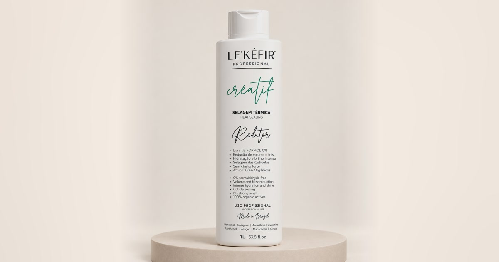

# Landing Page Le’Kéfir Créatif Organic

Landing page oficial do **Le’Kéfir Professional Créatif Organic – Redutor de Volume**, disponibilizada para afiliados autorizados divulgarem os produtos com seus próprios links de venda.

> **Afiliado:** baixe o projeto, substitua os links de checkout pelos seus links de afiliado e publique. A página já está pronta e não exige instalação, banco de dados ou processo de compilação.

[](https://lekefir.com.br/)

## Página publicada

**Landing page:** https://lekefir.com.br/

## O que você precisa alterar

Todos os links de compra estão centralizados no arquivo [`js/config.js`](js/config.js), dentro da lista `ofertas`.

Procure pelos cinco campos chamados `checkout`:

```js
ofertas: [
  {
    id: 'un1',
    checkout: 'COLE_AQUI_SEU_LINK_DE_AFILIADO',
  },
  {
    id: 'un2',
    checkout: 'COLE_AQUI_SEU_LINK_DE_AFILIADO',
  },
  {
    id: 'un3',
    checkout: 'COLE_AQUI_SEU_LINK_DE_AFILIADO',
  },
  {
    id: 'kit-duo',
    checkout: 'COLE_AQUI_SEU_LINK_DE_AFILIADO',
  },
  {
    id: 'kit-completo',
    checkout: 'COLE_AQUI_SEU_LINK_DE_AFILIADO',
  },
]
```

Substitua somente o conteúdo entre aspas de cada `checkout`. Mantenha a vírgula no final da linha.

Cada campo corresponde a uma oferta:

| Identificador | Oferta |
|---|---|
| `un1` | 1 Créatif Redutor 1L |
| `un2` | Kit com 2 Créatif Redutor 1L |
| `un3` | Kit com 3 Créatif Redutor 1L |
| `kit-duo` | Créatif Redutor 1L + Shampoo Antirresíduo 1L |
| `kit-completo` | Créatif Redutor 1L + Shampoo Antirresíduo 1L + Lisse Térmico 120ml |

Use o link de afiliado correspondente a cada oferta. Depois de editar, abra a página e teste todos os botões **Comprar agora** antes de começar a divulgação.

## Como baixar

### Opção 1: baixar o arquivo ZIP

1. Clique em **Code** no topo deste repositório.
2. Clique em **Download ZIP**.
3. Extraia o arquivo no computador.
4. Abra `js/config.js` em um editor de texto ou de código.
5. Troque os cinco links de checkout pelos seus links de afiliado.

### Opção 2: clonar com Git

```bash
git clone https://github.com/JohnGyn/lekefir-landing-page.git
cd lekefir-landing-page
```

Depois, edite `js/config.js` e substitua os campos `checkout`.

## Como testar no computador

O projeto usa apenas HTML, CSS e JavaScript. Se você tiver Python instalado, execute na pasta do projeto:

```bash
python3 -m http.server 4321
```

Abra http://localhost:4321 no navegador.

Também é possível usar uma extensão de servidor local, como **Live Server**, no editor de código.

## Como publicar

Como o projeto é estático, ele pode ser publicado em serviços como:

- Vercel;
- Netlify;
- Cloudflare Pages;
- hospedagem compartilhada com acesso ao gerenciador de arquivos;
- VPS com Nginx ou Apache.

Publique todo o conteúdo do repositório, preservando a estrutura das pastas. O arquivo `index.html` deve permanecer na raiz.

## Páginas de retorno do checkout

O projeto inclui páginas para os diferentes estados de pagamento:

| Situação | Caminho no seu domínio | Exemplo oficial |
|---|---|---|
| Pagamento aprovado | `/obrigado/` | https://lekefir.com.br/obrigado/ |
| Pix gerado | `/obrigado/pix/` | https://lekefir.com.br/obrigado/pix/ |
| Boleto gerado | `/obrigado/boleto/` | https://lekefir.com.br/obrigado/boleto/ |
| Pagamento em processamento | `/obrigado/processando/` | https://lekefir.com.br/obrigado/processando/ |

Ao publicar em outro domínio, troque apenas o domínio dos exemplos. Se a sua página estiver em `https://meusite.com.br`, a URL de pagamento aprovado será `https://meusite.com.br/obrigado/`.

## Rastreamento

A página preserva automaticamente parâmetros de campanha como `utm_source`, `utm_medium`, `utm_campaign` e `fbclid` ao enviar o visitante para o checkout.

O projeto contém o Meta Pixel usado na página oficial. Afiliados que precisarem usar um pixel próprio devem substituir a configuração de rastreamento antes de publicar. Essa alteração é opcional para quem precisa apenas trocar os links de venda.

## Estrutura do projeto

```text
.
├── index.html              # landing page
├── js/
│   ├── config.js           # links de checkout e configurações principais
│   ├── main.js             # comportamento da landing page
│   └── thank-you.js        # comportamento das páginas de retorno
├── css/                    # estilos da página
├── assets/                 # imagens, vídeos, fontes e ícones
└── obrigado/               # páginas de retorno do checkout
```

## Personalizações opcionais

Quem quiser personalizar outros dados pode usar estes arquivos:

| Alteração | Arquivo |
|---|---|
| WhatsApp, preços, frete, parcelamento e links de checkout | `js/config.js` |
| Textos e seções da landing page | `index.html` |
| Cores, fontes e espaçamentos | `css/style.css` |
| Estilo das páginas de retorno | `css/thank-you.css` |

Alterar preços, alegações sobre o produto ou informações regulatórias pode deixar a página diferente da comunicação oficial da marca. Para a divulgação como afiliado, a recomendação é trocar apenas os links de checkout.

## Uso do material

Este projeto é disponibilizado para divulgação dos produtos Le’Kéfir por afiliados autorizados. A marca, os textos, as imagens dos produtos e os demais materiais comerciais continuam pertencendo aos seus respectivos titulares.

Não remova informações obrigatórias do produto nem use a página para divulgar produtos de terceiros como se fossem da Le’Kéfir.

## Suporte

Em caso de dúvida sobre cadastro, aprovação ou geração dos links de afiliado, fale com o responsável pelo programa de afiliados da Le’Kéfir.
